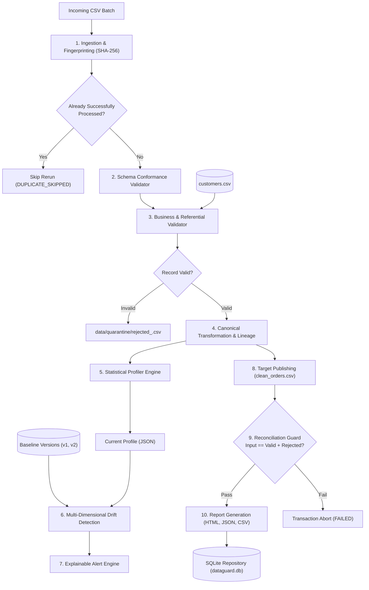

# DataGuard – Enterprise Data Quality & Drift Monitoring Platform

[](https://www.python.org/)
[](docs/TESTING.md)
[](docs/TESTING.md)
[](LICENSE)

**DataGuard** is a high-performance Python data engineering platform designed to protect production analytics, data lakes, and machine learning models from silent data degradation. It establishes versioned statistical baselines and continuously audits subsequent data batches for volume drift, null-rate divergence, continuous numerical distribution shifts, categorical cardinality changes, and event freshness violations.

---

## 1. Business Problem

Production data pipelines frequently suffer from **silent data corruption**:
- Upstream frontend or mobile app releases break field validation, causing missing values or empty strings to spike.
- Upstream database schemas change without notification or foreign key constraints are bypassed during high-load microservice migrations.
- Machine learning models degrade silently because input feature distributions shift (concept and covariate drift) while row counts appear unchanged.
- Duplicate data ingestion distorts revenue reporting, inventory accounting, and downstream financial reconciliation.

DataGuard addresses these challenges by enforcing rigorous schema validation, non-destructive quarantine isolation, multi-dimensional statistical drift detection, explainable alerts with actionable remediation steps, and audit-proof reconciliation balancing.

---

## 2. Key Features

- **Multi-Dimensional Drift Detection**:
  - **Volume Drift**: Percentage deviation against baseline with configurable Warning/Critical thresholds.
  - **Null-Rate Drift**: Column-level missingness shifts computed in percentage points.
  - **Numerical Distribution Drift (PSI)**: Standard Population Stability Index utilizing baseline histogram binning with boundary protection $(-\infty, +\infty)$ and $\epsilon$-smoothing.
  - **Categorical Distribution Drift (TVD)**: Total Variation Distance identifying probability mass shifts, brand-new categories, and missing categories.
  - **Freshness & Temporal Drift**: Event age SLA checks, chronological monotonicity auditing, and late-arriving record ($>30\text{d}$) detection.
- **Explainable Alert Engine**:
  - Eliminates cryptic alerts. Every notification provides actual measurements, baseline benchmarks, thresholds, deviation delta, clear plain-English explanation, and concrete remediation advice.
- **Zero Data Loss Quarantine**:
  - Invalid records are separated into `data/quarantine/rejected_<run_id>.csv` containing the complete original payload enriched with rejection codes, reasons, and timestamps.
- **Cryptographic Idempotency**:
  - Deterministic SHA-256 file fingerprinting ensures identical files are never accidentally processed or published twice.
- **Strict Reconciliation Audit**:
  - Validates $\text{Input Count} \equiv \text{Valid Count} + \text{Quarantined Count}$ before committing pipeline success.
- **High Throughput**:
  - Vectorized Pandas and NumPy operations deliver over **36,000 records/second** throughput on local commodity hardware.
- **Rich Multi-Format Reporting**:
  - Simultaneously generates standalone HTML dashboards (`report.html`), machine-readable telemetry (`report.json`), and alert exports (`alerts.csv`).

---

## 3. Architecture & Workflow



---

## 4. Technology Stack

- **Runtime**: Python 3.11+ (verified on 3.12, 3.14)
- **Data Processing**: Pandas, NumPy, SciPy
- **Schema Validation**: Pandera, Pydantic 2
- **CLI & Output**: Typer, Rich
- **Storage & Metadata**: SQLite, SQLAlchemy 2.0
- **Configuration**: PyYAML
- **Test Automation**: Pytest, Pytest-Cov

---

## 5. Project Directory Structure

```
dataguard/
├── README.md                           # Master project guide
├── pyproject.toml                      # Build metadata and dependencies
├── requirements.txt                    # Pinned package requirements
├── .gitignore                          # Standard git ignore definitions
├── .env.example                        # Environment variable template
│
├── config/
│   ├── settings.yaml                   # Platform paths, database, and logging
│   └── quality_rules.yaml              # Schema rules, business constraints, thresholds
│
├── data/
│   ├── input/                          # Reference datasets (customers.csv)
│   ├── generated/                      # Generated synthetic batches
│   ├── baseline/                       # Versioned golden profiles (v1, v2)
│   ├── output/                         # Published clean data and report directories
│   │   ├── clean_orders.csv
│   │   └── reports/<run_id>/
│   └── quarantine/                     # Isolated rejected rows (rejected_<run_id>.csv)
│
├── docs/
│   ├── ARCHITECTURE.md                 # System components and technical design
│   ├── DATA_DICTIONARY.md              # Column schemas, business constraints, error codes
│   ├── DESIGN_DECISIONS.md             # Key design choices, trade-offs, and rationale
│   ├── TESTING.md                      # Testing strategy, matrices, and execution
│   ├── PERFORMANCE.md                  # 1K, 10K, 100K scalability benchmarks
│   └── FINAL_VERIFICATION_REPORT.md    # Formal verification audit matrix
│
├── src/
│   └── dataguard/
│       ├── __init__.py
│       ├── main.py                     # Programmatic entry point
│       ├── cli.py                      # Typer CLI application
│       ├── config.py                   # Pydantic & YAML settings loader
│       ├── ingestion/
│       │   ├── __init__.py
│       │   └── csv_reader.py           # Ingestion, fingerprinting, run IDs
│       ├── validation/
│       │   ├── __init__.py
│       │   ├── schema_validator.py     # Pandera & structural schema validation
│       │   ├── business_validator.py   # Vectorized business rule validation
│       │   └── referential_validator.py# Customer foreign key validation
│       ├── transformation/
│       │   ├── __init__.py
│       │   └── transformer.py          # Type standardization and lineage tagging
│       ├── profiling/
│       │   ├── __init__.py
│       │   ├── profiler.py             # Granular column statistics & histograms
│       │   └── baseline.py             # Immutable baseline version management
│       ├── drift/
│       │   ├── __init__.py
│       │   ├── volume.py               # Volume drift calculator
│       │   ├── null_rate.py            # Null-rate divergence calculator
│       │   ├── numerical.py            # Population Stability Index (PSI)
│       │   ├── categorical.py          # Total Variation Distance (TVD)
│       │   └── freshness.py            # Staleness & chronology detector
│       ├── alerts/
│       │   ├── __init__.py
│       │   └── alert_engine.py         # Explainable alert generator
│       ├── storage/
│       │   ├── __init__.py
│       │   ├── database.py             # SQLAlchemy 2.0 schema & models
│       │   └── repository.py           # Relational repository & idempotency
│       ├── pipeline/
│       │   ├── __init__.py
│       │   └── orchestrator.py         # End-to-end workflow orchestrator
│       ├── reporting/
│       │   ├── __init__.py
│       │   └── report_generator.py     # HTML, JSON, and CSV report generator
│       ├── generator/
│       │   ├── __init__.py
│       │   └── synthetic_data.py       # Reproducible test batch generator
│       └── models/
│           ├── __init__.py
│           ├── alert.py                # Alert domain models & severities
│           ├── profile.py              # Statistical profile models
│           └── run.py                  # Pipeline execution & reconciliation models
│
├── tests/
│   ├── conftest.py                     # Pytest fixtures and test environments
│   ├── test_ingestion.py
│   ├── test_validation.py
│   ├── test_profiling.py
│   ├── test_volume_drift.py
│   ├── test_null_drift.py
│   ├── test_numerical_drift.py
│   ├── test_categorical_drift.py
│   ├── test_freshness.py
│   ├── test_idempotency.py
│   ├── test_reporting.py
│   ├── test_cli.py
│   └── test_integration.py
│
└── scripts/
    ├── generate_data.py                # CLI wrapper for data generation
    ├── run_sample.py                   # End-to-end sample execution script
    └── benchmark.py                    # Multi-scale scalability benchmark script
```

---

## 6. Installation & Setup

### Prerequisites
- Python 3.11 or newer installed
- Git installed

### 1. Create and Activate Virtual Environment
```bash
# Clone the repository
git clone <repo-url> dataguard
cd dataguard

# Create virtual environment
python -m venv .venv

# Activate on Windows PowerShell
.\.venv\Scripts\Activate.ps1

# (Or on Linux/macOS)
# source .venv/bin/activate
```

### 2. Install Dependencies
```bash
# Upgrade pip
pip install --upgrade pip

# Install in editable mode with development dependencies
pip install -e ".[dev]"
```

---

## 7. Quickstart Guide

### Step 1: Generate Synthetic Data
Generate realistic orders and customers datasets with controlled anomalies (10,000 rows, seed 42):
```bash
dataguard generate --rows 10000 --seed 42
```
*Generated datasets:*
- `data/input/customers.csv`: Customer reference table
- `data/generated/orders_baseline.csv`: Golden profile data
- `data/generated/orders_normal.csv`: Production valid batch
- `data/generated/orders_drifted.csv`: Shifted volume, nulls, PSI, TVD, and freshness
- `data/generated/orders_invalid.csv`: Intentional constraint violations (quarantine test)

### Step 2: Establish the Golden Baseline
```bash
dataguard baseline --input data/generated/orders_baseline.csv
```
This profiles the golden dataset, assigns immutable version `v1`, persists it to `data/baseline/orders_baseline_v1.json`, and registers it in `dataguard.db`.

### Step 3: Run the Pipeline on a Normal Batch
```bash
dataguard run --input data/generated/orders_normal.csv
```
*Result:* Status `SUCCESS`, 10,000 valid records published, 0 quarantined, 0 drift alerts.

### Step 4: Run the Pipeline on a Drifted Batch
```bash
dataguard run --input data/generated/orders_drifted.csv
```
*Result:* Automatically detects:
- **Volume Drift (WARNING)**: -35.92% volume drop
- **Null-Rate Drift (CRITICAL)**: Missing customer email rate jumped from 1.74% to 15.78% (+14.04 percentage points)
- **Numerical Drift (CRITICAL)**: PSI of 3.42 on `order_amount` (mean shifted from $109 to $460)
- **Categorical Drift (CRITICAL)**: TVD of 0.31 on `order_status` (cancelled orders surged)
- **Freshness Drift (CRITICAL)**: Latest event timestamp is 840 hours old ($> 168\text{h}$ SLA)

### Step 5: Run the Pipeline on an Invalid Batch
```bash
dataguard run --input data/generated/orders_invalid.csv
```
*Result:*
- **Valid records published**: 800 rows appended to `data/output/clean_orders.csv`
- **Quarantine segregation**: 200 invalid rows written to `data/quarantine/rejected_<run_id>.csv`
- **Reconciliation balance**: 1000 input = 800 valid + 200 quarantined (100% Balanced).

### Step 6: Verify Idempotency Protection
Run the exact same normal batch file again:
```bash
dataguard run --input data/generated/orders_normal.csv
```
*Result:* Status `DUPLICATE_SKIPPED`. The system checks the file's SHA-256 fingerprint, identifies previous successful processing, and prevents duplicate records from being appended to `clean_orders.csv`.

---

## 8. CLI Reference

| Command | Flags / Options | Description |
|---|---|---|
| `dataguard generate` | `--rows`, `--seed`, `--output-dir` | Generates reproducible synthetic orders and customer tables. |
| `dataguard baseline` | `--input`, `--dataset` | Profiles data and establishes a new versioned baseline. |
| `dataguard run` | `--input`, `--dataset`, `--customers`, `--force` | Executes complete ingestion, validation, drift detection, and reporting. |
| `dataguard report` | `--run-id` | Displays report locations and metrics for a specific pipeline execution. |
| `dataguard history` | `--limit` | Displays historical pipeline runs and outcomes from the database. |
| `dataguard benchmark` | `--rows`, `--seed` | Runs performance benchmark across specified row scale. |
| `dataguard --help` | None | Displays help and available commands. |

---

## 9. Automated Testing & Code Coverage

Run the comprehensive test suite:
```bash
pytest -v
```

Run test coverage report:
```bash
pytest -v --cov=dataguard --cov-report=term-missing
```

### Coverage Highlights:
- **49 passed tests** (0 failed, 0 skipped).
- **94% total codebase coverage**.
- Isolated fixtures, in-memory databases, and zero filesystem side effects.

---

## 10. Performance Benchmarks

Run the built-in multi-scale benchmark:
```bash
python scripts/benchmark.py
```

### Actual Local Measurements:
- **1,000 rows**: 0.13 seconds (**7,670 rows/sec**)
- **10,000 rows**: 0.34 seconds (**29,344 rows/sec**)
- **100,000 rows**: 2.73 seconds (**36,637 rows/sec**)

Full benchmark analysis and extrapolation is documented in [docs/PERFORMANCE.md](docs/PERFORMANCE.md).

---

## 11. Reporting & Observability

Every pipeline execution produces a dedicated reporting folder in `data/output/reports/<run_id>/`:
1. **`report.html`**: Interactive HTML report featuring:
   - Summary metric cards (Input, Valid, Quarantined, Alert Counts)
   - Audit-proof reconciliation balance badge
   - Explainable alerts table with actionable recommendations
   - Comparative null-rate and volume drift cards
   - Population Stability Index (PSI) breakdown
   - Total Variation Distance (TVD) category breakdown
   - Freshness & event age status
2. **`report.json`**: Complete machine-readable serialized telemetry.
3. **`alerts.csv`**: Tabular export ready for webhook or incident management ingestion (Slack, PagerDuty, Jira).
4. **`profile.json`**: Granular column-level statistical summary.
5. **`reconciliation.json`**: Formal mathematical proof of record balance.
6. **`run_summary.json`**: Executive metadata and execution times.

---

## 12. Known Limitations & Future Roadmap

### Known Limitations:
1. **Single-Node In-Memory Processing**: DataGuard loads each batch into Pandas DataFrames. Datasets exceeding single-node RAM ($> 20\text{GB}$) require chunked streaming.
2. **Relational Database Default**: Out-of-the-box configuration uses SQLite, which supports only single-writer concurrency. For distributed Celery/Airflow workers, point `DATAGUARD_DB_URL` to PostgreSQL.

### Future Roadmap:
- [ ] PyArrow / Polars backend for sub-millisecond execution on $> 10\text{M}$ records.
- [ ] Native Slack, MS Teams, and PagerDuty webhook dispatchers.
- [ ] Airflow and Prefect custom operators for seamless DAG integration.
- [ ] Web-based UI dashboard for browsing historical baselines and drift curves.

---

## 13. License

Distributed under the MIT License. See `LICENSE` for details.
