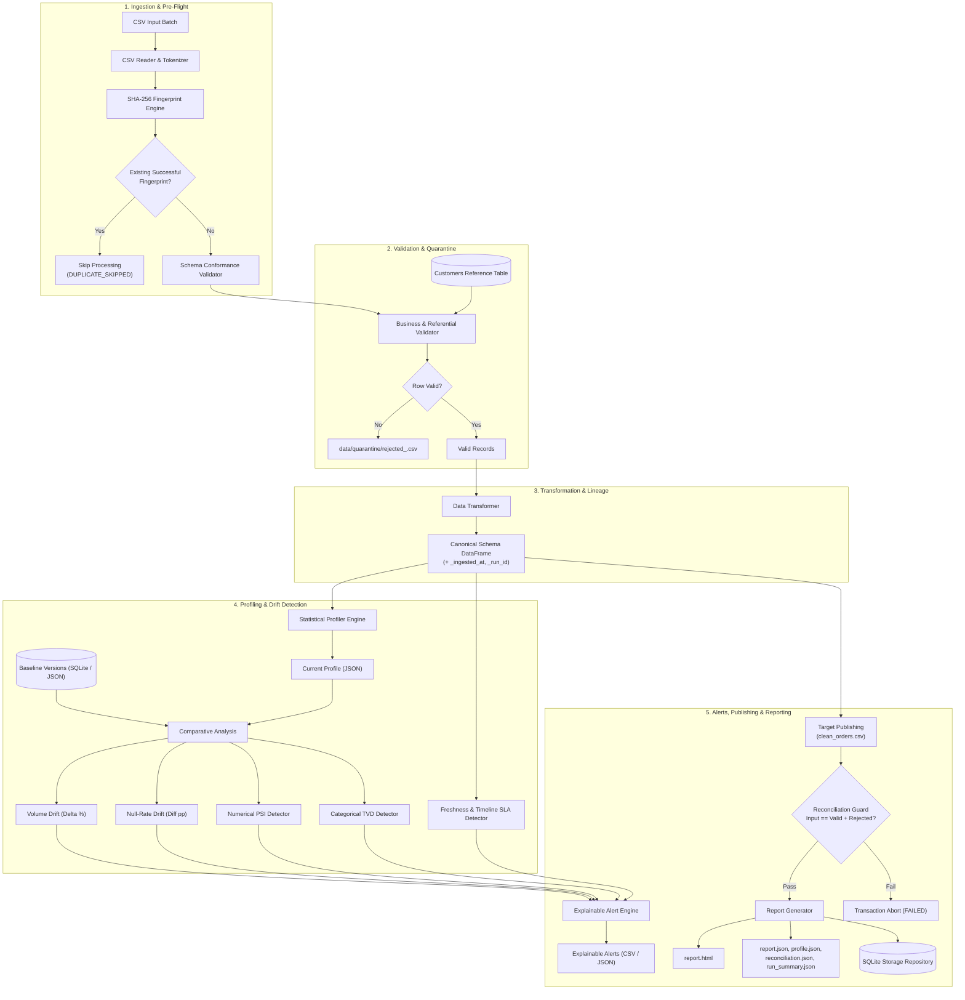

# DataGuard Architecture Specification

DataGuard is an enterprise-grade Data Quality & Drift Monitoring platform designed to protect production analytics, data lakes, and machine learning models from silent data degradation.

---

## 1. System Architecture Overview

The platform is designed around a strictly decoupled, modular pipeline architecture:

---

## 2. Core Subsystems

### A. Ingestion & Idempotency Layer (`dataguard.ingestion`)
- **CSV Stream Ingestion**: Detects 0-byte files, missing delimiters, empty dataframes, and structural corruption.
- **Cryptographic Fingerprinting**: Calculates a deterministic SHA-256 hash of the incoming file byte stream before processing.
- **Run Tracking**: Assigns an immutable, timestamped identifier (`run_YYYYMMDD_HHMMSS_<uuid8>`).
- **Idempotency Protection**: Checks whether an identical fingerprint previously reached a terminal `SUCCESS` state. If so, skips duplicate reprocessing unless `--force` is explicitly provided.

### B. Validation & Quarantine Subsystem (`dataguard.validation`)
- **Schema Validation**: Ensures all required business columns exist and flags unexpected fields.
- **Vectorized Business Rules**: Employs vectorized boolean masks in NumPy/Pandas for sub-second rule evaluation over hundreds of thousands of records.
- **Referential Integrity**: Verifies foreign keys (`customer_id`) against customer lookup tables.
- **Zero-Loss Quarantine**: Records failing validation are segregated into `data/quarantine/rejected_<run_id>.csv`. Every rejected record retains its full original payload augmented with:
  - `_rejection_source_file`
  - `_rejection_run_id`
  - `_rejection_error_code`
  - `_rejection_reason`
  - `_rejection_timestamp`

### C. Profiling & Baseline Versioning (`dataguard.profiling`)
- **Granular Column Statistics**:
  - *General*: Total rows, null counts, unique counts, duplicates, missingness rates.
  - *Numerical*: Min, max, mean, median, standard deviation, quartiles (p25, p50, p75), histogram bins and counts.
  - *Categorical*: Frequencies, proportions, top 10 categories, new/missing categories.
  - *Datetime*: Min timestamp, max timestamp, latest event age in hours, chronological monotonicity.
- **Immutable Versioning**: Baselines are saved to `data/baseline/orders_baseline_v<N>.json` and tracked in SQLite. Previous versions are deactivated rather than overwritten.

### D. Multi-Dimensional Drift Detection (`dataguard.drift`)
1. **Volume Drift**:
   $$\Delta_{\text{vol}} = \frac{N_{\text{current}} - N_{\text{baseline}}}{N_{\text{baseline}}} \times 100$$
   Thresholds: $\pm 20\%$ Warning, $\pm 40\%$ Critical. Handles zero baseline safely.
2. **Null-Rate Drift**:
   $$\Delta_{\text{null}} = \text{Rate}_{\text{current}} - \text{Rate}_{\text{baseline}} \quad (\text{percentage points})$$
   Thresholds: $+5.0\,\text{pp}$ Warning, $+10.0\,\text{pp}$ Critical.
3. **Numerical Distribution Drift (Population Stability Index - PSI)**:
   $$\text{PSI} = \sum_{i=1}^{K} (A_i - E_i) \times \ln\left(\frac{A_i}{E_i}\right)$$
   Reuses baseline histogram bin edges with boundary extension $(-\infty, +\infty)$ and $\epsilon$-smoothing ($10^{-4}$) to prevent numerical instability.
   Thresholds: $\text{PSI} \ge 0.10$ Warning, $\text{PSI} \ge 0.25$ Critical.
4. **Categorical Distribution Drift (Total Variation Distance - TVD)**:
   $$\text{TVD} = \frac{1}{2} \sum_{c \in C} |P(c) - Q(c)|$$
   Detects new unexpected categories and missing historical categories.
   Thresholds: $\text{TVD} \ge 0.10$ Warning, $\text{TVD} \ge 0.25$ Critical.
5. **Freshness & Timeline Drift**:
   Calculates latest event staleness against configured SLA hours ($48\text{h}$ Warning, $168\text{h}$ Critical). Flags out-of-order sequence arrivals and late-arriving records ($>30\text{d}$).

### E. Explainable Alert Engine (`dataguard.alerts`)
- Generates structured, diagnostic alerts without hardcoded values.
- Pairs every anomaly with actual measured deviation, configured thresholds, human-readable explanations, and concrete remediation instructions.

### F. Target Publishing & Strict Reconciliation (`dataguard.pipeline`)
- Publishes validated records to `data/output/clean_orders.csv` with lineage attributes (`_ingested_at`, `_run_id`).
- Strictly enforces reconciliation balance:
  $$\text{Input Count} \equiv \text{Valid Count} + \text{Quarantined Count}$$
- If reconciliation fails, transaction status is marked `FAILED` and target publishing is rejected.

### G. Visual & Machine-Readable Reporting (`dataguard.reporting`)
- Generates 6 unified reporting artifacts per execution:
  1. `report.html` (Interactive dark-mode operational dashboard)
  2. `report.json` (Full serialized telemetry)
  3. `alerts.csv` (Tabular alert export for notification routing)
  4. `profile.json` (Granular statistical summary)
  5. `reconciliation.json` (Audit-proof record balancing)
  6. `run_summary.json` (High-level run outcome)
